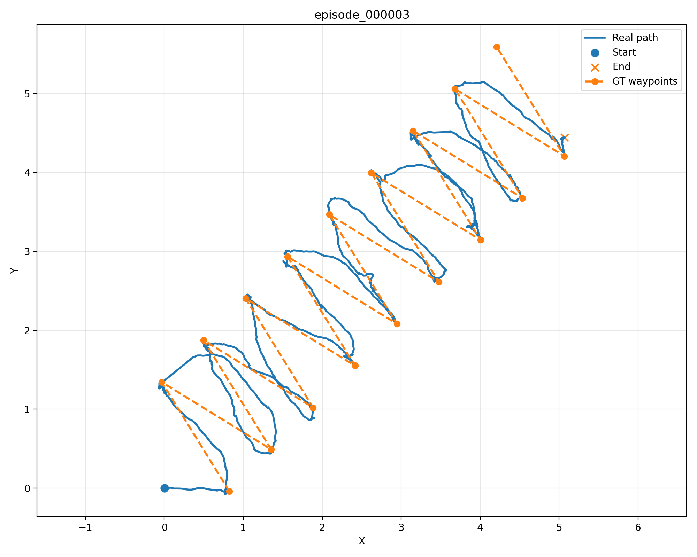

# Hexapod · High-Level Motion Control

**ROS 2 controllers for six-legged robot gaits, keyboard teleoperation, waypoint navigation and motion-log analysis.**

English | [Русский](README.ru.md)

This repository explores the **high-level locomotion layer** of a hexapod robot. Python ROS 2 nodes translate movement commands into six joint-position targets, compare different stepping patterns and record motion data. An autonomous node creates waypoint paths and selects discrete movement commands from odometry. Separate analysis scripts and archived episode data are provided for evaluating trajectories and learning experiments.



*Example archived trajectory: executed path (blue) and waypoints (orange). This image is an experiment artifact, not a claim of benchmark accuracy.*

## Features

- **Gait experiments:** tripod, wave, diagonal, quadruped-style and four/two stepping strategies.
- **Keyboard controllers** in `hexapod_movement/0_keyboard_*.py` for direct testing.
- **ROS 2 interfaces** for joint-state feedback, actuator targets, odometry and external commands.
- **Autonomous discrete navigation** along square, circle, polygon or figure-eight waypoint patterns.
- **CSV motion logging** via `hexapod_logger.py` for experiment analysis.
- **Episode visualization** using Matplotlib, pandas and Plotly; stored CSV/JSON recordings and HTML examples.

> **Project scope:** `rl/analyze/` contains analysis utilities and archived episode data. A complete reinforcement-learning training environment and trainer are **not included** in this repository snapshot.

## Requirements

- Linux with a compatible ROS 2 distribution and Python environment supporting `rclpy`.
- ROS 2 message packages: `std_msgs`, `sensor_msgs`, `nav_msgs`.
- A **separate running hexapod simulation or hardware bridge** publishing joint states and odometry and accepting six joint targets.
- For data analysis: `numpy`, `pandas`, `matplotlib`, `plotly`.

This is a collection of Python nodes rather than an installable ROS 2 package: there is no `package.xml`, launch file or model/world configuration in this archive.

## Quick start: a gait controller

After sourcing ROS 2 and launching your existing hexapod simulator/bridge, run one of the controllers:

```bash
source /opt/ros/jazzy/setup.bash  # change if you use another ROS 2 distro
cd hexapod_movement
python3 tripod.py
```

In another terminal, send a **discrete command** (for the external-command controllers):

```bash
ros2 topic pub --once /hexapod_0/command std_msgs/msg/String '{data: "w"}'
```

The command vocabulary is `w` / `a` / `s` / `d` (forward, left, backward, right in the controller convention) and empty string or `stop` to stop. Some variants implement different stepping behavior; inspect the chosen controller before running real actuators.

Alternatively, experiment with an interactive script from the same directory:

```bash
python3 0_keyboard_tripod.py
```

Keyboard variants use Unix terminal input (`termios`, `tty`), so run them in a normal Linux terminal.

## Autonomous waypoint navigation

For a controller such as `tripod.py` already listening on `/hexapod_0/command`, start the navigator from the repository root:

```bash
python3 hexapod_movement/autonomous_controller.py \
  --ros-args -p trajectory_kind:=square -p square_side:=12.0
```

The navigator subscribes to `/hexapod_0/odom` and publishes discrete `std_msgs/String` commands to `/hexapod_0/command`. Parameters include `trajectory_kind`, `radius`, `polygon_sides`, `loop`, `waypoint_tolerance` and `control_rate_hz`. This **assumes a compatible simulator and coordinate frame**; the repository does not supply the simulator itself.

## Control and data flow

```text
Keyboard / waypoint navigator
           │ std_msgs/String: /hexapod_0/command
           ▼
      Gait controller  <── /hexapod_0/joint_states
           │
           └───────────> /hexapod_0/set_position_targets

      Odometry / dataset topics ──> HexapodLogger ──> CSV files
```

## Repository layout

```text
hexapod_movement/
  tripod.py, waves.py, ...          external-command gait controllers
  0_keyboard_*.py                   interactive keyboard variants
  autonomous_controller.py          waypoint generator and navigator
  hexapod_logger.py                 CSV logging helper
  logs/, log_int_0.1/               archived movement logs
  well it works/, not working/      historical experiments; not canonical entry points
rl/analyze/
  plot_training_metrics*.py         learning-metric plots from recorded CSV
  plot_*trajectories.py             trajectory plots
  episode/trajectory_animation_html.py  standalone HTML trajectory animation
  output_plot/, output_plots/       saved trajectory illustrations
  episode/, ...                     archived episode data and analysis outputs
```

## Example: analysis of recorded data

The analysis utilities accept file paths and do not require the original simulator once the logs are available. For example:

```bash
python3 rl/analyze/episode/trajectory_animation_html.py \
  --input PATH_TO_EPISODE_CSV --output trajectory.html
```

The input must contain the columns expected by the script; use an appropriate per-step episode CSV from the archived data. The training metrics script accepts a `training_metrics.csv` file as a positional argument; its expected schema is defined in `plot_training_metrics.py`.

## Status and limitations

- The repository records multiple **experimental** gait/controller variants, including explicitly unsuccessful ones. Not every script is a maintained stable interface.
- ROS 2 launch/configuration and a complete Gazebo hexapod world are not bundled here; connect your own simulator or physical bridge.
- Recorded episode plots represent specific runs and do not establish comparative controller performance without a common evaluation protocol.
- No separate top-level project licence was included in the uploaded archive.
