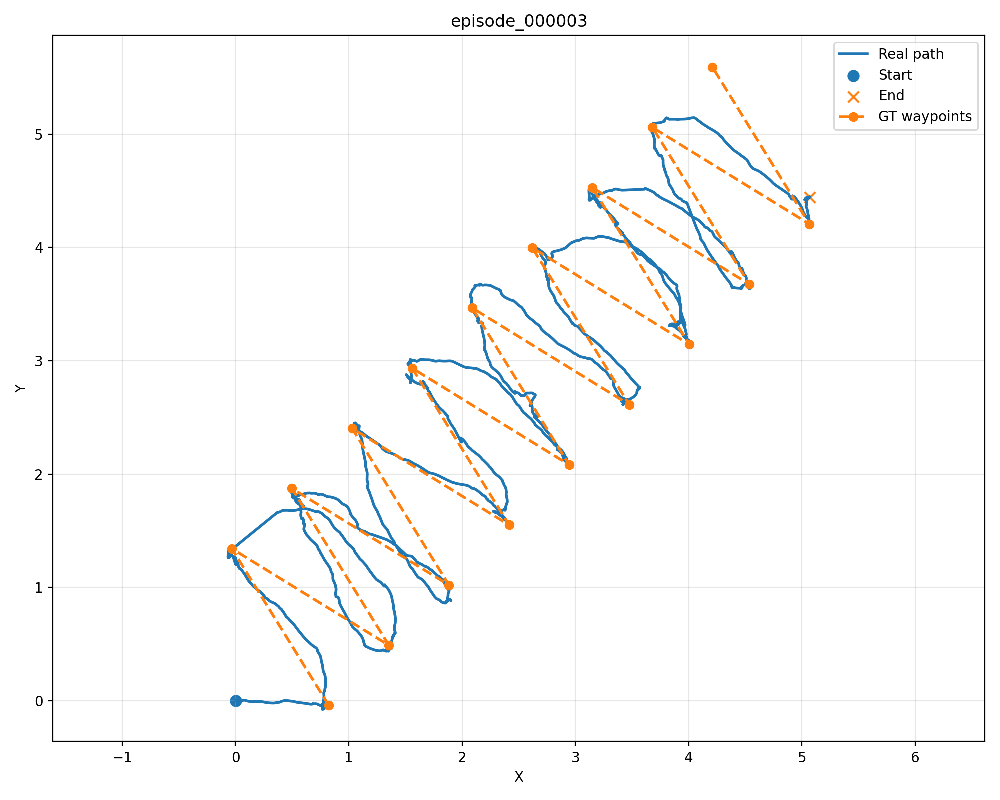

# Hexapod · верхний уровень управления

**Алгоритмы походок гексапода, управление с клавиатуры, движение по путевым точкам и анализ траекторий на ROS 2.**

[English](README.md) | Русский

Репозиторий посвящён **верхнему уровню управления движением** шестиногого робота. Узлы на Python и ROS 2 преобразуют команды движения в задания для шести сочленений, позволяют исследовать разные схемы шагания и сохраняют данные. Отдельный автономный контроллер формирует траектории по путевым точкам и выбирает дискретные команды по одометрии. Есть инструменты анализа и архивы экспериментальных прогонов.



*Пример одного из сохранённых прогонов: фактическая траектория (синяя) и путевые точки (оранжевые). Это иллюстрация эксперимента, а не универсальная оценка качества.*

## Возможности

- **Исследование походок:** tripod, wave, diagonal, quadro и схема four/two.
- **Управление с клавиатуры:** скрипты `hexapod_movement/0_keyboard_*.py`.
- **Топики ROS 2:** состояния сочленений, целевые положения приводов, одометрия и внешние команды.
- **Автономное движение:** квадрат, круг, многоугольник, восьмёрка из путевых точек.
- **Логирование в CSV** с помощью `hexapod_logger.py`.
- **Анализ эпизодов:** Matplotlib, pandas, Plotly, сохранённые CSV/JSON и HTML-анимации.

> **Границы проекта:** в `rl/analyze/` есть программы анализа и результаты экспериментов, но полного окружения и скриптов **обучения RL-агента** в переданном архиве нет.

## Требования

- Linux и совместимая версия ROS 2 с Python-пакетом `rclpy`.
- Сообщения ROS 2: `std_msgs`, `sensor_msgs`, `nav_msgs`.
- **Отдельный симулятор гексапода или мост к оборудованию**, публикующий состояния сочленений и одометрию и принимающий задания по шести каналам.
- Для графиков: `numpy`, `pandas`, `matplotlib`, `plotly`.

Это коллекция Python-узлов, а не готовый устанавливаемый пакет ROS 2: в архиве нет `package.xml`, launch-файла или конфигурации мира робота.

## Быстрый старт: управление походкой

После настройки ROS 2 и запуска своего симулятора или аппаратного моста выполните:

```bash
source /opt/ros/jazzy/setup.bash  # замените, если установлена другая версия ROS 2
cd hexapod_movement
python3 tripod.py
```

Во втором терминале отправьте дискретную команду:

```bash
ros2 topic pub --once /hexapod_0/command std_msgs/msg/String '{data: "w"}'
```

Контроллер понимает `w` / `a` / `s` / `d` (вперёд, влево, назад, вправо в принятой системе команд); остановка — пустая строка или `stop`. У вариантов походок разные алгоритмы движения — перед испытаниями на настоящих приводах изучите выбранный скрипт.

Можно попробовать и интерактивный режим из того же каталога:

```bash
python3 0_keyboard_tripod.py
```

Для скриптов с клавиатурой нужен обычный терминал Linux (`termios`, `tty`).

## Движение по траектории

При уже запущенном контроллере, который принимает команды в `/hexapod_0/command` (например, `tripod.py`), из корня репозитория запустите:

```bash
python3 hexapod_movement/autonomous_controller.py \
  --ros-args -p trajectory_kind:=square -p square_side:=12.0
```

Навигатор получает `/hexapod_0/odom` и публикует дискретные команды `std_msgs/String` в `/hexapod_0/command`. Параметры: `trajectory_kind`, `radius`, `polygon_sides`, `loop`, `waypoint_tolerance`, `control_rate_hz` и др. Для работы нужен **совместимый симулятор с корректной системой координат**; готовой модели мира внутри репозитория нет.

## Поток управления

```text
Клавиатура / навигатор по точкам
           │ std_msgs/String: /hexapod_0/command
           ▼
      Алгоритм походки  <── /hexapod_0/joint_states
           │
           └───────────> /hexapod_0/set_position_targets

      Одометрия / датасет ──> HexapodLogger ──> CSV
```

## Структура репозитория

```text
hexapod_movement/
  tripod.py, waves.py, ...          походки с внешними командами
  0_keyboard_*.py                   варианты с управлением с клавиатуры
  autonomous_controller.py          генератор траектории и навигатор
  hexapod_logger.py                 сохранение CSV
  logs/, log_int_0.1/               архивы движения
  well it works/, not working/      исторические эксперименты, не основные скрипты
rl/analyze/
  plot_training_metrics*.py         графики метрик обучения из CSV
  plot_*trajectories.py             визуализация траекторий
  episode/trajectory_animation_html.py  генерация HTML-анимации
  output_plot/, output_plots/       готовые изображения траекторий
  episode/, ...                     экспериментальные данные и результаты
```

## Пример анализа результатов

Инструменты анализа принимают файлы и после получения данных не требуют работающего симулятора:

```bash
python3 rl/analyze/episode/trajectory_animation_html.py \
  --input PATH_TO_EPISODE_CSV --output trajectory.html
```

В CSV должны быть столбцы, ожидаемые скриптом; используйте подходящий файл с пошаговым эпизодом. `plot_training_metrics.py` принимает позиционным аргументом файл `training_metrics.csv`, структура которого определяется кодом анализатора.

## Статус и ограничения

- В репозитории есть **экспериментальные** варианты, в том числе явно помеченные как неработающие. Не все файлы — стабильные точки входа.
- Полный мир Gazebo, установка ROS 2 и общая конфигурация запуска здесь не поставляются; подключите свой симулятор или аппаратный мост.
- Графики отражают отдельные прогоны и без общей процедуры оценки не доказывают преимущество конкретного алгоритма.
- Отдельной лицензии проекта в переданном архиве нет.
