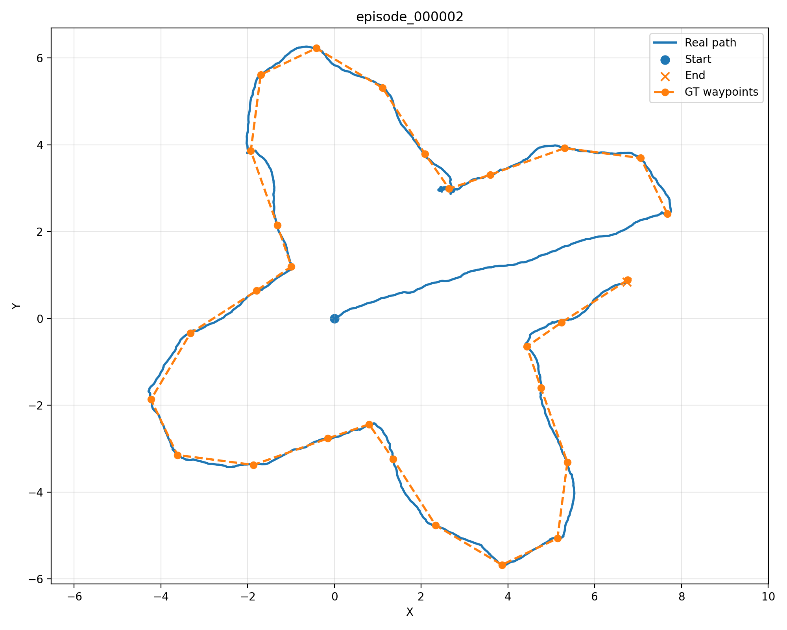

# Hexapod_3_High_Level

**Высокоуровневое управление шестиногим роботом типа RHex в ROS 2 и Gazebo: пять походок, контроллеры CPG и фазовых осцилляторов, автономная навигация по точкам и инструменты анализа эпизодов обучения с подкреплением.**

[English](README.md) | Русский



*Записанный эпизод: реальный путь (синий) идёт по точкам эталона в форме клевера (оранжевый); достигнуты 28 из 28
точек за 2 326 шагов.*

Робот ходит на шести вращающихся ногах, по одному мотору на ногу, поэтому походка — это правило, когда и как быстро
крутится каждый мотор. Этот репозиторий — верхний уровень стека Hexapod: Python-узлы ROS 2, превращающие команду с
клавиатуры, фазовый осциллятор или список точек в целевые углы шести моторов, записывающие, что сделал робот, и набор
скриптов для оценки эпизодов обученной политики. Нижние уровни — это [координатор среднего уровня](https://github.com/<your-account>/Hexapod_2_Middle_Level)
и [моторные платы](https://github.com/<your-account>/Hexapod_1_Low_Level); здесь роботом служит модель Gazebo
`hexapod_0`.

## Возможности

* **Пять походок**: трипод (ноги `0, 3, 4` против `1, 2, 5`), диагонали, четыре-два, волны и quadro, каждая как
  клавиатурный контроллер: `W/A/S/D` — идти и поворачивать, `Space` или `X` — остановиться. Шаг — это небольшой автомат,
  который ждёт, пока активная группа ног провернётся достаточно, и только потом отпускает следующую.
* **Контроллер CPG** (`cpg.py`): шесть связанных фазовых осцилляторов, два трипода зафиксированы в противофазе,
  регулятор курса ведёт робота по окружности, цикл 50 Гц.
* **Контроллер на фазовых осцилляторах** (`phase_oscillator.py`): та же идея с выбираемыми эталонными путями
  (окружность, эллипс, восьмёрка, фигура Лиссажу, зигзаг, квадрат, прямоугольник) и ПД-регулятором курса.
* **Дифференциальный контроллер** (`diff_drive.py`): ноги каждого борта приводятся как колёса дифференциального привода
  для движения по окружности, ограничение скорости 13 рад/с, цикл 20 Гц.
* **Автономный навигатор** (`autonomous_controller.py`): строит траекторию из точек (квадрат, окружность, многоугольник
  или восьмёрка), читает одометрию и публикует одну из четырёх дискретных команд (`w`, `a`, `s`, `d`) в
  `/hexapod_0/command`; о том, какая походка их исполняет, он ничего не знает.
* **Логирование** (`hexapod_logger.py`): CSV с углом, скоростью и током каждого мотора, а также `x, y, φ` и их
  приращениями с фиксированной частотой; логи экспериментов с походками лежат в `hexapod_movement/logs/`.
* **Анализ RL** (`rl/analyze/`): 498 записанных эпизодов с метриками, графики кривых обучения и траекторий и анимация
  траектории.

### Интерфейс ROS 2

| топик | тип | направление | что |
|---|---|---|---|
| `/hexapod_0/set_position_targets` | `std_msgs/Float64MultiArray` | контроллер → робот | цели для шести моторов |
| `/hexapod_0/joint_states` | `sensor_msgs/JointState` | робот → контроллер | положения и скорости суставов |
| `/hexapod_0/dataset` | `std_msgs/Float64MultiArray` | робот → контроллер | телеметрия моторов: угол, скорость, ток |
| `/hexapod_0/odom` | `nav_msgs/Odometry` | робот → контроллер | поза для навигации и логов |
| `/hexapod_0/command` | `std_msgs/String` | навигатор → походка | `w`, `a`, `s`, `d` |

### Что показывают записанные эпизоды RL

В JSON каждого эпизода лежат награда, признак успеха, причина остановки, среднеквадратичные расстояния до цели и до
пути, ошибка курса, крен и тангаж, длина пути и число достигнутых точек. Из 498 эпизодов в репозитории 235 дошли до
конца траектории и 263 закончились по таймауту; средняя доля пройденного пути — 0,80.

| путь | эпизодов | завершено | | путь | эпизодов | завершено |
|---|---|---|---|---|---|---|
| line | 25 | 25 | | straight | 33 | 32 |
| curve | 31 | 31 | | ellipse | 18 | 18 |
| square | 25 | 24 | | figure8 | 19 | 17 |
| circle | 31 | 27 | | clover | 77 | 30 |
| spiral | 81 | 29 | | zigzag | 74 | 2 |
| lissajous | 84 | 0 | | | | |

> Эпизоды получены из нескольких запусков обучения политики, среда обучения которой не входит в этот репозиторий,
> поэтому читайте таблицу как картину того, какие пути были трудными, а не как бенчмарк.

## Требования

* Ubuntu 24.04, ROS 2 Jazzy (`rclpy`, `std_msgs`, `sensor_msgs`, `nav_msgs`);
* запущенная симуляция гексапода в пространстве имён `hexapod_0` (модель Gazebo и мост ROS), которая публикует
  перечисленные топики и принимает `set_position_targets`;
* для скриптов анализа: Python ≥ 3.10 с pandas и matplotlib.

## Быстрый старт

```bash
git clone https://github.com/<your-account>/Hexapod_3_High_Level.git
cd Hexapod_3_High_Level/hexapod_movement
source /opt/ros/jazzy/setup.bash

python3 0_keyboard_tripod.py          # идти на W/A/S/D, остановка — Space или X
python3 0_keyboard_waves.py           # то же с другой походкой
python3 cpg.py                        # движение по окружности на связанных осцилляторах
python3 phase_oscillator.py           # путь выбирается через `self.mode` в файле
python3 autonomous_controller.py      # навигация по точкам (по умолчанию квадрат)
```

Скрипты запускаются из `hexapod_movement/`, потому что импортируют `hexapod_logger`. Коэффициенты, шаги и пороги лежат в
начале каждого контроллера.

### Анализ эпизодов

```bash
cd rl/analyze
python3 plot_successful_trajectories.py --help
python3 plot_partial_trajectories.py --help
python3 plot_training_metrics.py <training_metrics.csv>      # кривые обучения, разбитые на сессии
python3 traj_anim.py --help                                  # анимация траектории
```

## Структура репозитория

```
hexapod_movement/
  0_keyboard_<gait>.py     клавиатурные контроллеры с логированием: tripod, diagonals, four_two, waves, quadro (+ tripod_z_fall)
  <gait>.py, new_<gait>.py другие версии тех же походок
  cpg.py                   связанные фазовые осцилляторы, движение по окружности
  phase_oscillator.py      генератор походки с выбираемыми эталонными путями
  diff_drive.py            движение по окружности в стиле дифференциального привода
  autonomous_controller.py навигатор по точкам → команды w/a/s/d
  hexapod_logger.py        CSV-логирование моторов и позы
  logs/                    записанные прогоны по походкам
rl/analyze/
  episodes/                498 сводок эпизодов (JSON) и один пошаговый лог (CSV)
  output_plots/            графики траекторий избранных эпизодов
  plot_*.py, traj_anim.py  метрики, траектории, анимация
```

## Часть стека Hexapod

| уровень | репозиторий | работает на |
|---|---|---|
| 1 — моторы | [Hexapod_1_Low_Level](https://github.com/<your-account>/Hexapod_1_Low_Level) | STM32F103C8T6 × 3 |
| 2 — координация | [Hexapod_2_Middle_Level](https://github.com/<your-account>/Hexapod_2_Middle_Level) | STM32F446RE |
| 3 — походки и навигация | **Hexapod_3_High_Level** | ROS 2 / Gazebo |
